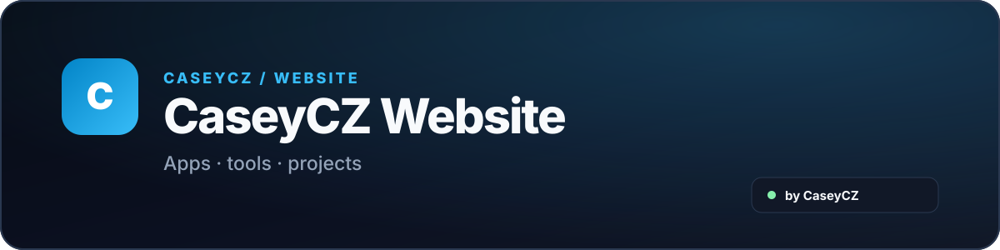

  

  
  

  Hlavní web <strong>CaseyCZ</strong> — aplikace, nástroje a projekty na jednom místě.

  

## O webu

**CaseyCZ Website** je přehled hlavních aplikací a projektů — HB Control, TubeTV, PiTV, Abaku, GameS Calendar, Scriptable Apps, iOS Hub a Stremio Addons. Aktuální verze vybraných aplikací sdílí s [GitHub profilem](https://github.com/CaseyCZ).

## Projekty

<table>
  <thead><tr><th>Projekt</th><th>Info</th><th>Odkazy</th></tr></thead>
  <tbody>
    <tr><td><strong>HB Control</strong></td><td>Správa Homebridge pro iPhone a iPad.</td><td></td></tr>
    <tr><td><strong>TubeTV</strong></td><td>YouTube pro Apple TV s TizenTube.</td><td></td></tr>
    <tr><td><strong>GameS Calendar</strong></td><td>Herní kalendář vydání s IGDB.</td><td> </td></tr>
    <tr><td><strong>Abaku</strong></td><td>Číselná hra proti AI i online.</td><td> </td></tr>
    <tr><td><strong>Scriptable Apps</strong></td><td>Widgety a hry: Piškvorky, Breakout, Pong.</td><td> </td></tr>
    <tr><td><strong>iOS Hub</strong></td><td>AltStore, FlareStore, Feather a import zkratkou.</td><td> </td></tr>
    <tr><td><strong>Travel Checklist</strong></td><td>Cestovní seznamy a sdílení.</td><td></td></tr>
    <tr><td><strong>Stremio Sosáč</strong></td><td>Katalogy a streamy pro Stremio.</td><td> </td></tr>
    <tr><td><strong>Sosáč Subtitles</strong></td><td>Stremio titulky s Apple fallbackem.</td><td> </td></tr>
    <tr><td><strong>Stremio Addons</strong></td><td>Čtyři zdroje pro Stremio.</td><td></td></tr>
  </tbody>
</table>

## Podpora

  

   
  Naskenuj QR kód nebo klikni na tlačítko.

